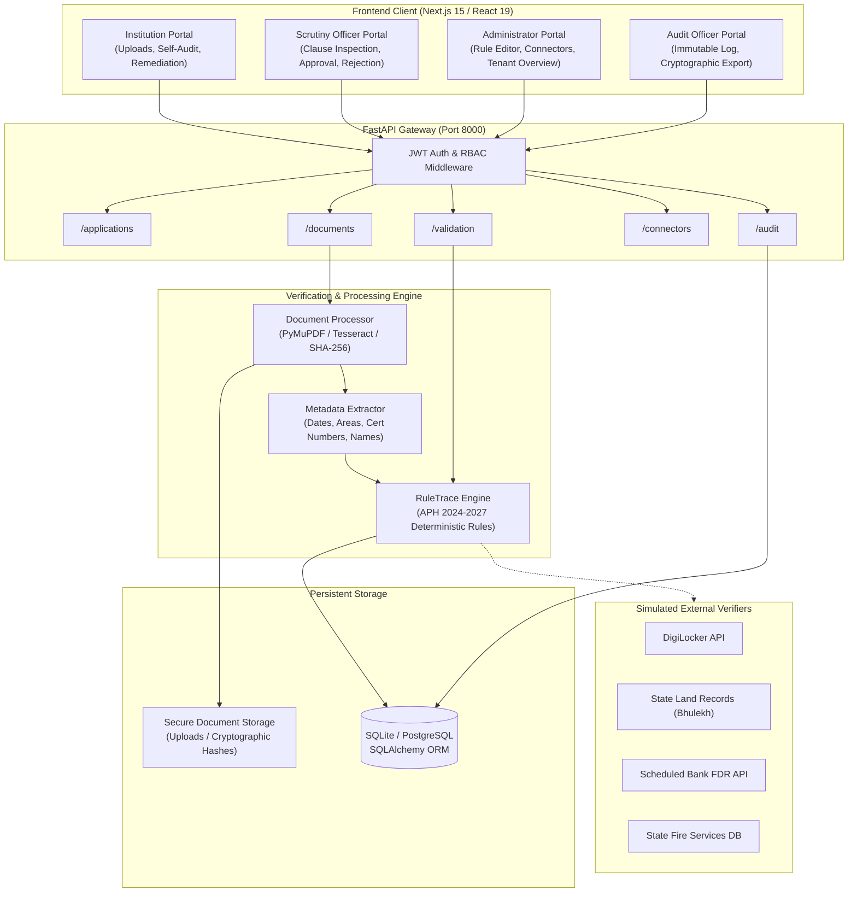

# RuleTrace AI — Regulatory Compliance & Document Verification Engine

[](https://opensource.org/licenses/MIT)
[](https://fastapi.tiangolo.com)
[](https://nextjs.org)
[](https://www.python.org/)
[](https://www.typescriptlang.org/)
[](https://www.sih.gov.in/)

> **Smart India Hackathon 2026** | **Problem Statement**: SIH26261  
> **Title**: AI-Powered Application Validation, Document Authentication and Regulatory Compliance Verification  
> **Target Organization**: All India Council for Technical Education (AICTE)  
> **Theme**: Smart Automation | **Team**: UNCUT GEMS

---

## 📑 Table of Contents
1. [Project Identity & Overview](#-project-identity--overview)
2. [Problem & Proposed Solution](#-problem--proposed-solution)
3. [Key Features & Implementation Matrix](#-key-features--implementation-matrix)
4. [System Architecture & Data Flow](#-system-architecture--data-flow)
5. [Technology Stack](#-technology-stack)
6. [Repository Structure](#-repository-structure)
7. [Prerequisites](#-prerequisites)
8. [Installation & Setup](#-installation--setup)
9. [Environment Variables](#-environment-variables)
10. [Demonstration & Evaluation Walkthrough](#-demonstration--evaluation-walkthrough)
11. [Testing & Quality Verification](#-testing--quality-verification)
12. [Regulatory Framework & Legal Basis](#-regulatory-framework--legal-basis)
13. [Security, Integrity & Anti-Fraud Architecture](#-security-integrity--anti-fraud-architecture)
14. [Limitations & Future Roadmap](#-limitations--future-roadmap)
15. [Team UNCUT GEMS](#-team-uncut-gems)

---

## 🏛️ Project Identity & Overview

Every academic year, the **All India Council for Technical Education (AICTE)** receives over 10,000 complex applications from technical institutions across India seeking:
- Grant of New Technical Institutions (Chapter I)
- Extension of Approval (EoA) for existing institutions (Chapter II)
- Increase / Variation in Intake or Introduction of New Courses
- Closure or Change of Site / Location

Processing these applications requires evaluating hundreds of pages of legal, financial, architectural, and safety documentation per institution. Manual scrutiny is painstakingly slow, prone to oversight, and susceptible to recycled documents, expired safety certificates, conflicting land measurements, and forged notary declarations.

**RuleTrace AI** is an intelligent, automated regulatory compliance verification and document authentication platform built specifically for AICTE. It combines deterministic legal rule execution, OCR-based clause extraction, multi-document cross-verification, and cryptographic document fingerprinting into an explainable, audit-ready workbench.

---

## 🎯 Problem & Proposed Solution

| Challenge in Current Manual Workflow | RuleTrace AI Automated Solution |
| ------------------------------------ | -------------------------------- |
| **High Scrutiny Latency**: 3–6 weeks per institution to manually cross-reference 10+ statutory documents. | **Sub-second Verification**: Instant rule execution across all documents with automated deficiency tagging. |
| **Subtle Discrepancies**: Land deed states 10.5 Acres, but Affidavit states 8.0 Acres or wrong survey numbers. | **Cross-Document Entity Corroboration**: Automatic entity matching across Land Deeds, Master Plans, Affidavits, and University NOCs. |
| **Recycled & Duplicate Documents**: Unscrupulous trusts re-uploading identical land deeds across multiple colleges. | **Global Cryptographic Deduplication**: SHA-256 fingerprinting flags identical files submitted by distinct institutions. |
| **Expired Statutory Clearances**: Fire Safety NOC or Bank Guarantees expiring mid-academic-session. | **Temporal Validity Checks**: Explicit calculation of validity windows against AICTE academic cut-off dates. |
| **Black-Box AI Skepticism**: Reviewers reject AI systems that cannot cite exact legal clauses. | **Deterministic Clause Traceability**: Every finding is explicitly linked to AICTE APH Chapter, Clause, and Page citations with extracted evidence snippets. |

---

## ⚡ Key Features & Implementation Matrix

Each feature in RuleTrace AI is classified according to its implementation state:
- `[x] Implemented`: Fully implemented, operational in frontend and backend.
- `[~] Simulated`: Functional mock / sandbox simulator simulating real external services.
- `[ ] Roadmap`: Architecture planned for production scaling.

| Capability | Module | Status | Description |
| ---------- | ------ | :----: | ----------- |
| **AICTE APH 2024–2027 Rule Engine** | `validation_engine.py` | `[x]` | 12+ deterministic validation rules enforcing mandatory annexures, area thresholds, validity periods, and joint FDR requirements. |
| **Document OCR & Metadata Extraction** | `document_processing.py` | `[x]` | High-speed PDF text parsing via PyMuPDF with Tesseract OCR fallback, regex entity extraction (dates, certificates, areas, names). |
| **Cross-Document Discrepancy Matching** | `validation_engine.py` | `[x]` | Cross-references land area, institution name, survey numbers, and FDR values between separate uploaded files. |
| **SHA-256 Document Fingerprinting** | `document_processing.py` | `[x]` | Cryptographic hashing at ingestion; detects document reuse/duplication across distinct institution IDs. |
| **Role-Based Portals (4 Personas)** | `app/page.tsx` | `[x]` | Tailored dashboards for **Institution Officer**, **Scrutiny Officer / Reviewer**, **Administrator**, and **Audit Officer**. |
| **Deficiency Report Generator** | `frontend & backend` | `[x]` | Generates formal, printable deficiency notices with legal citations, severity levels (`CRITICAL`, `WARNING`, `INFO`), and resolution suggestions. |
| **Immutable Audit Trail** | `models.py`, `app/api/` | `[x]` | Tamper-evident event log recording uploads, rule evaluations, status transitions, reviewer comments, and timestamps. |
| **Synthetic Scenario Generator** | `seed.py` | `[x]` | 8 pre-seeded SIH evaluation scenarios illustrating compliant cases, land shortfalls, expired NOCs, forged affidavits, and recycled deeds. |
| **External Regulatory Connectors** | `routes/connectors.py` | `[~]` | Simulated integration sandbox with DigiLocker, State Land Records (Bhulekh), State Fire Services, and Bank FDR verification APIs. |
| **Distributed Asynchronous Celery OCR** | Backend Architecture | `[ ]` | Distributed queue worker for batch processing 10,000+ simultaneous multi-gigabyte application dossiers. |

---

## 🏗️ System Architecture & Data Flow



### Complete Verification Lifecycle
1. **Ingestion**: An applicant uploads PDFs/documents under AICTE Annexure 2 categories.
2. **Hashing & Storage**: The system generates a cryptographic SHA-256 hash and persists the file.
3. **Information Extraction**: PyMuPDF extracts text streams; regex models parse structured metadata (certificate IDs, issue/expiry dates, land measurements in Acres/Sq.m, institution names, joint FDR lien clauses).
4. **Deterministic Validation**: The `validation_engine` checks completeness, temporal validity, cross-document congruence, and cross-application duplicate fingerprints.
5. **Traceable Findings**: Every deficiency is stored with severity level, exact APH clause citation, and verbatim evidence snippets.
6. **Multi-Role Scrutiny**: The Scrutiny Officer inspects flagged deficiencies side-by-side with document previews and makes an official determination (Approve, Reject, Request Resubmission).

---

## 🛠️ Technology Stack

| Layer | Technologies | Rationale |
| ----- | ------------ | --------- |
| **Frontend** | Next.js 15.2 (App Router), React 19, TypeScript, Tailwind CSS, Lucide React | High-performance server/client components, zero-latency state transitions, accessible responsive layout. |
| **Backend** | Python 3.11+, FastAPI, Pydantic v2, Uvicorn, Python-Multipart | Ultra-low latency asynchronous API gateway, native OpenAPI/Swagger self-documentation, rigorous type safety. |
| **Database & ORM** | SQLAlchemy 2.0, SQLite (Local Dev) / PostgreSQL (Production ready) | Seamless relational models for applications, documents, rules, findings, and immutable audit logs. |
| **Document Processing & OCR** | PyMuPDF (fitz), Pillow, Pytesseract, SHA-256 | High-throughput native C-level PDF parsing; OCR fallback for scanned certificates and stamps. |
| **Security & Auth** | Python-Jose, Passlib, Bcrypt | Industry-standard JWT tokens with role-based claim enforcement. |
| **Testing & CI** | Pytest, HTTPX TestClient, Next.js ESLint, GitHub Actions | Complete automated regression testing, code quality gates, and build verification. |

---

## 📁 Repository Structure

```
ruletrace/
├── .github/
│   └── workflows/
│       └── ci.yml                  # GitHub Actions continuous integration workflow
├── backend/
│   ├── app/
│   │   ├── api/
│   │   │   └── routes/             # REST endpoints (auth, apps, docs, rules, audit, etc.)
│   │   ├── core/                   # Security, JWT, configuration, settings
│   │   ├── db/                     # Database session setup & 8 SIH scenario seeders
│   │   ├── models/                 # SQLAlchemy database models
│   │   ├── schemas/                # Pydantic v2 request & response schemas
│   │   ├── services/
│   │   │   ├── document_processing.py  # PDF text extraction & OCR parsing
│   │   │   └── validation_engine.py    # APH 2024-2027 legal compliance rules
│   │   └── main.py                 # FastAPI application root & middleware
│   ├── tests/
│   │   └── test_api.py             # Pytest automated API & validation test suite
│   ├── uploads/
│   │   ├── documents/              # Storage for uploaded document binaries
│   │   └── temp/                   # Temporary upload processing cache
│   └── requirements.txt            # Pinned backend Python dependencies
├── frontend/
│   ├── app/
│   │   ├── lib/
│   │   │   └── api.ts              # Type-safe API client for FastAPI backend
│   │   ├── layout.tsx              # Root HTML & Next.js metadata wrapper
│   │   ├── page.tsx                # Unified 4-role scrutiny & audit dashboard
│   │   └── globals.css             # Tailwind design tokens & utility styles
│   ├── package.json                # Frontend package dependencies & scripts
│   ├── tsconfig.json               # TypeScript configuration
│   ├── eslint.config.mjs           # Next.js ESLint configuration
│   └── .env.example                # Frontend environment template
├── sample_documents/               # Synthetic test documents (PDF & TXT) for SIH demo
├── .editorconfig                   # Consistent code indentation & formatting rules
├── .gitignore                      # Git exclusion rules for node, python, db & caches
├── .env.example                    # Global environment configuration template
├── CONTRIBUTING.md                 # Developer contribution guidelines
├── LICENSE                         # MIT open-source license
├── SECURITY.md                     # Security policy & vulnerability reporting
├── start_prototype.bat             # Windows one-click startup launcher
└── README.md                       # Comprehensive project documentation
```

---

## 📦 Prerequisites

Ensure the following tools are installed on your machine:
- **Python**: `3.10` or higher (`python --version`)
- **Node.js**: `18.0` or higher (`node --version`)
- **Package Managers**: `pip` and `npm`
- **Tesseract OCR (Optional)**: Required only if testing OCR extraction on raw scanned images without embedded text layers.
  - Windows: [UB-Mannheim Tesseract Installer](https://github.com/UB-Mannheim/tesseract/wiki)
  - Ubuntu/Debian: `sudo apt-get install tesseract-ocr`
  - macOS: `brew install tesseract`

---

## 🚀 Installation & Setup

### 1. Clone the Repository
```bash
git clone https://github.com/<your-username>/ruletrace.git
cd ruletrace
```

### 2. Configure Environment Variables
```bash
# Copy the example environment configuration
cp .env.example backend/.env
cp frontend/.env.example frontend/.env.local
```
*(Default settings use SQLite locally and connect frontend to `http://localhost:8000/api/v1` without manual configuration).*

### 3. Backend Setup & Startup
```bash
cd backend
python -m venv .venv

# Activate virtual environment:
# On Windows:
.venv\Scripts\activate
# On Linux/macOS:
source .venv/bin/activate

pip install -r requirements.txt
python -m uvicorn app.main:app --host 127.0.0.1 --port 8000 --reload
```
- API Root: `http://127.0.0.1:8000`
- Interactive OpenAPI Swagger Docs: `http://127.0.0.1:8000/docs`

### 4. Frontend Setup & Startup
In a separate terminal:
```bash
cd frontend
npm install
npm run dev
```
- Web Application: `http://localhost:3000`

---

## 🔐 Environment Variables

| Variable | Default Value | Description |
| -------- | ------------- | ----------- |
| `DATABASE_URL` | `sqlite:///./ruletrace.db` | SQLAlchemy connection string (SQLite for dev, PostgreSQL for prod). |
| `SECRET_KEY` | `change-this-in-production` | Secret key used for cryptographic JWT signing. |
| `ALGORITHM` | `HS256` | JWT signature algorithm. |
| `ACCESS_TOKEN_EXPIRE_MINUTES` | `480` | Access token lifespan (8 hours). |
| `UPLOAD_DIR` | `./uploads/documents` | Storage path for ingested documents. |
| `MAX_FILE_SIZE_MB` | `20` | Maximum allowable upload file size. |
| `TESSERACT_CMD` | `tesseract` | Binary executable command or full path for Tesseract OCR. |
| `CORS_ORIGINS` | `http://localhost:3000,http://127.0.0.1:3000` | Allowed origin domains for CORS headers. |
| `DEMO_MODE` | `true` | Auto-seeds 8 SIH demonstration scenarios on startup. |
| `NEXT_PUBLIC_API_URL` | `http://localhost:8000/api/v1` | Backend API endpoint consumed by the Next.js client. |

---

## 🎬 Demonstration & Evaluation Walkthrough

RuleTrace AI includes **Quick Persona Switching** on the login screen to demonstrate all four roles in minutes:

| Persona | Role | Default Email | Password |
| ------- | ---- | ------------- | -------- |
| **Dr. Rajesh Sharma** | Institution Officer | `principal@apextech.edu` | `demo123` |
| **Prof. Anita Sen** | Scrutiny Officer / Reviewer | `reviewer@aicte.gov.in` | `demo123` |
| **Vikram Malhotra** | AICTE Administrator | `admin@aicte.gov.in` | `demo123` |
| **Justice R. Verma** | Compliance & Vigilance Auditor | `auditor@aicte.gov.in` | `demo123` |

### Walkthrough 1: Flawless Submission & Reviewer Approval
1. **Login as Institution Officer** (`principal@apextech.edu`):
   - Notice application `AICTE-2024-25-57GDHI` (*Apex Institute of Technology*).
   - Click **Upload Documents** and select the 6 compliant documents from `sample_documents/`:
     - `01_AFFIDAVIT_2_Compliant.pdf`
     - `02_TER_PAYMENT_RECEIPT_Compliant.pdf`
     - `03_OCCUPANCY_CERTIFICATE_Compliant.pdf`
     - `04_FIRE_SAFETY_CERTIFICATE_Compliant.pdf`
     - `05_SATELLITE_MAP_Compliant.pdf`
     - `06_AUDITED_ACCOUNTS_Compliant.pdf`
   - Alternatively, use the built-in **Synthetic AICTE Document Generator** to generate compliant templates.
2. **Execute Validation**:
   - Click **Run AICTE APH Validation**.
   - Notice: **0 Deficiencies Found** (100% Compliance Score).
3. **Submit Application**:
   - Click **Submit Application to AICTE Scrutiny Committee**. Status transitions from `DRAFT` to `SUBMITTED`.
4. **Switch to Scrutiny Officer** (`reviewer@aicte.gov.in`):
   - Select `AICTE-2024-25-57GDHI`.
   - Inspect the verified documents, zero deficiencies, and rule checks.
   - Click **Sign-Off & Approve Application**.
   - Status updates to `APPROVED` with an immutable digital timestamp.

### Walkthrough 2: Investigating Critical Deficiencies
1. **Switch to Scrutiny Officer** and select pre-seeded test cases:
   - `AICTE-2024-25-18KLMN` (*Shivaji College of Engineering*):
     - **Deficiency Flagged**: Land Area Shortfall (Only 5.2 Acres provided vs 7.5 Acres required under APH Appendix 4).
   - `AICTE-2024-25-33MNOP` (*Kalinga Institute*):
     - **Deficiency Flagged**: Expired Fire Safety Certificate (Expired 30 days prior to submission cut-off date).
   - `AICTE-2024-25-44QRST` (*Vanguard Polytechnic*):
     - **Deficiency Flagged**: Affidavit Non-Compliance (Missing mandatory anti-ragging declaration under Annexure 2).
2. **Inspect Traceability**:
   - Click on any finding to inspect the **Traceability Card**:
     - Exact AICTE APH Chapter & Clause reference.
     - Verbatim excerpt extracted from the document.
     - Remediation advice for the institution.

### Walkthrough 3: Administrator & Audit Oversight
1. **Switch to Administrator** (`admin@aicte.gov.in`):
   - Review global approval/rejection metrics across all institutions.
   - Inspect and toggle live verification connectors (DigiLocker, State Bhulekh, Bank FDR API).
   - Inspect the active AICTE rule library.
2. **Switch to Audit Officer** (`auditor@aicte.gov.in`):
   - Inspect the chronological, tamper-evident audit log of every document upload, rule evaluation, and status transition.
   - Click **Export Audit Dossier** to download a verifiable compliance report.

---

## 🧪 Testing & Quality Verification

RuleTrace AI includes an automated test suite verifying all critical compliance rules and API endpoints:

### Run Backend Pytest Suite
```bash
cd backend
python -m pytest
```
```
collected 6 items
tests/test_api.py::test_health_endpoint PASSED                    [ 16%]
tests/test_api.py::test_login_success PASSED                      [ 33%]
tests/test_api.py::test_login_invalid_credentials PASSED          [ 50%]
tests/test_api.py::test_get_applications PASSED                   [ 66%]
tests/test_api.py::test_validation_engine_execution PASSED        [ 83%]
tests/test_api.py::test_full_annexure2_compliant_submission PASSED [100%]

============================== 6 passed in 1.42s ==============================
```

### Run Frontend Linting & Build
```bash
cd frontend
npm run lint
npm run build
```
- `npm run lint`: Exits with code `0` (0 errors).
- `npm run build`: Compiles production Next.js bundle cleanly.

---

## 📖 Regulatory Framework & Legal Basis

RuleTrace AI encodes statutory requirements directly from the official **AICTE Approval Process Handbook (APH 2024–2027)**:

| AICTE Regulation | Statutory Requirement | RuleTrace AI Enforcement |
| ---------------- | --------------------- | ------------------------ |
| **Chapter I, Clause 1.3** | Mandatory Establishment Documents | Validates Registration of Society/Trust, Resolution, and MOA. |
| **Chapter II, Clause 2.4** | Extension of Approval (EoA) Documents | Enforces mandatory submission of 6 Annexure 2 documents before submission. |
| **Annexure 2, Item 1** | Self-Declaration Affidavit on Rs. 100 Stamp Paper | Verifies stamp value, notary signature date, and mandatory anti-ragging/infrastructure clauses. |
| **Annexure 2, Item 2** | Processing Fee (TER) Receipt | Confirms payment transaction ID, timestamp, and correct fee slab. |
| **Annexure 2, Item 3** | Occupancy / Completion Certificate | Validates issuing municipal authority and building plan validity. |
| **Annexure 2, Item 4** | Fire Safety Certificate | Confirms Fire Safety NOC validity extending throughout the entire academic year. |
| **Appendix 4, Norms** | Land Area Requirements | Enforces minimum land thresholds (Urban: 2.5 Acres, Mega/Metro: 1.5 Acres, Rural: 7.5 Acres). |
| **Appendix 6, Norms** | Fixed Deposit Receipt (FDR) Lien | Ensures FDR is created jointly in the name of the Regional Officer, AICTE and the applicant trust for the prescribed tenure. |

---

## 🛡️ Security, Integrity & Anti-Fraud Architecture

1. **Cryptographic SHA-256 Hashing**:
   - Every file uploaded is hashed at the byte level upon receipt.
   - Detects fraudulent reuse of identical land deeds, fire NOCs, or building plans across different institutions.
2. **Deterministic & Explainable Evaluation**:
   - Unlike non-deterministic LLMs that may hallucinate rules, RuleTrace AI executes strictly deterministic rule logic based on exact legal thresholds, providing transparent audit trails.
3. **Role-Based Access Control (RBAC)**:
   - Strict privilege separation prevents unauthorized status transitions or review tampering.
4. **Tamper-Evident Audit Trail**:
   - Every user action, automated scan, and reviewer decision is recorded with actor ID, timestamp, and change delta.
5. **Zero Private Data Exposure**:
   - All sample records, names, survey numbers, and credentials included in this repository are **100% synthetic** mock data created specifically for demonstration.

---

## 🗺️ Limitations & Future Roadmap

### Current Prototype Limitations
- **External API Connectivity**: Integrations with national portals (DigiLocker, State Bhulekh Land Records, Bank FDR APIs) run in high-fidelity simulated sandbox mode due to real-world government API access restrictions.
- **Multilingual OCR**: Current OCR models specialize in English and Hindi statutory documents. Regional language land deeds (e.g., Marathi 7/12 extracts, Tamil Patta) require pre-translation or specialized multilingual OCR pipelines.
- **Single-Host Processing**: In the current demo setup, document extraction and validation run synchronously within the FastAPI worker rather than a distributed Celery/RabbitMQ cluster.

### Production Roadmap
- [ ] **Phase 1 (Post-Hackathon)**: Production integration with DigiLocker API and State Revenue Land Registry gateways.
- [ ] **Phase 2**: Distributed OCR pipeline using Apache Tika and Celery workers for parallelized processing of 500+ page institutional portfolios.
- [ ] **Phase 3**: Integration of Indian multilingual vision models for regional land deed authentication.
- [ ] **Phase 4**: Automated GIS satellite boundary verification comparing claimed survey coordinates against high-resolution Bhuvan / ISRO imagery.

---

## 👥 Team UNCUT GEMS

Developed with ❤️ for **Smart India Hackathon 2026** by **Team UNCUT GEMS**:

| Team Member | Domain / Focus Area |
| ----------- | ------------------- |
| **Team Lead** | Full-Stack Architecture, Regulatory Validation Engine & System Integration |
| **Developer 2** | Frontend UX/UI, Role-Based Dashboards & Next.js Implementation |
| **Developer 3** | Document Extraction, OCR Pipelines & Regex Metadata Parsers |
| **Developer 4** | Database Architecture, Audit Trails & API Gateway Security |
| **Developer 5** | AICTE Regulatory Research, APH Legal Mapping & Synthetic Scenario Design |
| **Developer 6** | Quality Assurance, Testing Frameworks & Deployment Engineering |

---

*RuleTrace AI — Delivering Transparency, Efficiency, and Integrity to Higher Education Regulatory Scrutiny.*
